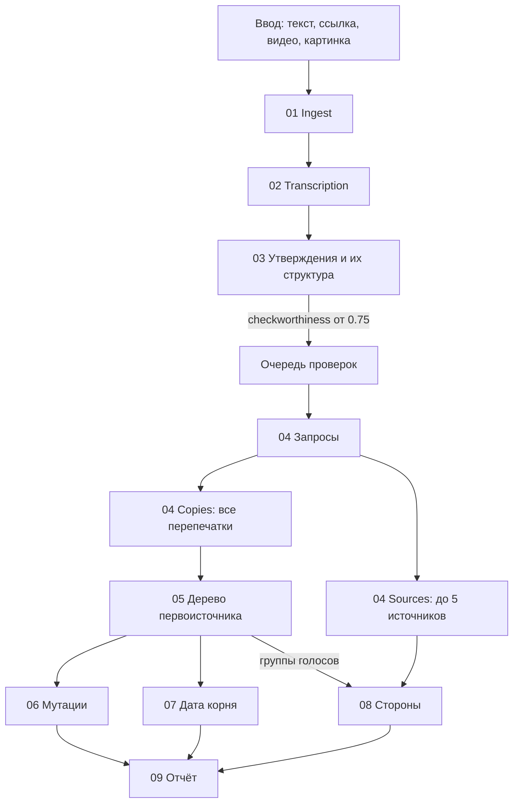

# Как работает движок

Движок работает в две фазы. Первая разбирает материал на утверждения, вторая проверяет их по одному.

## Как выбирается итог

Условия идут сверху вниз, первое сработавшее закрывает решение:

1. Большинство источников против: `against`.
2. Есть серьёзный флаг (старый контент, раздуто, искажение): `flagged`.
3. Поиск оставил жёсткий пробел: `unverifiable`.
4. Иначе решает подсчёт сторон: `converge`, `split` или `unverifiable`.

Итог считает код. LLM читает тексты и определяет позицию каждого источника.

## Где выдача теряла качество

- Ранняя копия должна была содержать число из тезиса, поэтому оригинал с другой цифрой отбрасывался.
- Ранний поиск шёл одним запросом на одном языке.
- Ссылки и «по данным…» на источники вне найденных копий просто терялись.
- Две заметки со ссылкой на один не найденный источник считались двумя независимыми голосами.
- Разбор, ссылающийся на фейк, попадал в группу этого фейка.
- Ссылки брались со всей страницы, включая боковые ленты.

Что с этим сделано: [[04_Что_изменено]].
